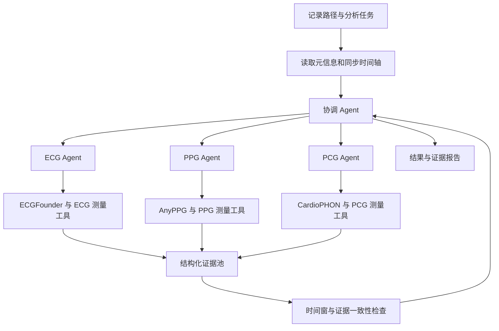

# CardioAgent 第一版项目方案

版本：v1.0<br>
编写日期：2026-11-11<br>
阶段：方案设计，尚未部署模型或完成仓库复现

## 1. 项目目标与第一版交付

项目面向 ECG、PPG、PCG 三种生理信号，构建由协调 Agent 和三个模态专家组成的心血管分析系统。每个专家可以读取病例信息、调用专用模型与信号处理工具、检查实际返回结果，并决定是否进一步分析。

最终研究方向是多模态辅助诊断。第一版完成可运行的信号分析与协作原型，主任务为同一记录中的心搏频率估计、模态一致性检查，以及质量下降或模态缺失时的复核。输出包括分析结果、证据来源、工具调用轨迹和未解决的问题。

第一版交付四项内容：

1. 可读取一条真实同步 ECG、PPG、PCG 记录的分析入口。
2. 基于 LangChain 和 LangGraph 的四个 Agent，以及实际执行的模型和测量工具。
3. 可回溯到记录、时间窗、通道和工具输出的结构化报告。
4. 小规模评测结果，覆盖正常执行、低质量输入、模态缺失和专家结果冲突。

项目首先加载现有模型权重。新增分类头、信号模型微调和 Agent 后训练均由明确的任务需求触发。

## 2. 框架选择与仓库使用方式

| 组件 | 选择 | 第一版用途 |
|---|---|---|
| 专家 Agent | LangChain `create_agent` | 提供 LLM 选择工具、执行工具、读取观察结果并继续决策的循环 |
| 系统编排 | LangGraph | 保存病例状态，管理专家子流程、并发调用、复核路由与停止条件 |
| ECG 模型 | ECGFounder | 加载现有检查点，接入已验证的分类输出和表征提取 |
| PPG 模型 | AnyPPG | 加载预训练编码器，提取表征，按任务决定是否接预测头 |
| PCG 模型 | CardioPHON | 加载心音预训练骨干，核验质量模块和已训练分类模块 |
| 语言模型 | 暂定 Qwen3-8B | 使用一个模型服务承载不同专家角色，验证结构化工具调用能力 |
| 医疗协作基线 | MedAgents、MDAgents | 参考独立分析、汇总、复核和按任务复杂度组织协作的方法 |
| 后训练扩展 | Agent Lightning | 在后续阶段评估轨迹采集与强化学习接入 |

MedAgents 和 MDAgents 的公开实现主要服务论文中的医学问答实验。MedAgents 通过角色提示词和预设调用流程组织协作，MDAgents 进一步封装了 Agent、Group 和难度分流。第一版采用 LangChain 和 LangGraph 提供工具型 Agent 的运行机制，并在该系统上实现可比较的医学协作策略。

语言模型暂定 Qwen3-8B 是本方案的初始选型，最终根据工具调用成功率、推理资源和上下文需求确定。各角色具有独立消息历史、工具集合和任务提示，可以共用同一个推理服务。

参考：[LangChain Agents](https://docs.langchain.com/oss/python/langchain/agents)、[LangGraph](https://docs.langchain.com/oss/python/langgraph/overview)、[Qwen3-8B](https://huggingface.co/Qwen/Qwen3-8B)、[MedAgents](https://github.com/gersteinlab/MedAgents)、[MDAgents](https://github.com/mitmedialab/MDAgents)。

## 3. 第一版分析流程



每次分析按以下步骤执行：

1. 用户指定记录及任务，系统读取通道、采样率、时长和缺失信息。
2. 协调 Agent 根据任务向可用模态专家分派分析请求。
3. 专家选择时间窗与通道，调用真实工具，依据工具返回决定是否继续检查。
4. 工具输出写入证据池。数值、标签和测量结果均保留来源。
5. 一致性检查比较相同时间窗内的结果，标识缺失、失败和分歧。
6. 协调 Agent 决定补充分析、请求复核或结束，输出结果和证据引用。

例如，ECG 与 PPG 得到不同频率估计时，协调 Agent 可以要求 PPG 专家检查该窗口的信号质量、切换另一个已有 PPG 通道或检查脉搏检测位置。每次复核都须产生新工具结果或对已有证据的具体解释。

## 4. 四个 Agent 的职责和动作

| 角色 | 输入 | 可执行动作 | 输出 |
|---|---|---|---|
| 协调 Agent | 分析任务、可用模态、专家结果 | 分派专家、指定复核问题、请求统一时间窗分析、完成报告 | 综合结论、证据引用、仍存在的分歧 |
| ECG Agent | ECG 通道与时间窗 | 检查质量、检测 R 峰、计算心率、调用兼容的 ECGFounder 检查点、复查片段 | ECG 测量和分类证据 |
| PPG Agent | PPG 通道与时间窗 | 检查质量、选择采集部位、检测脉搏、计算脉率、提取 AnyPPG 表征、调用可用任务头 | PPG 测量及已验证的模型输出 |
| PCG Agent | PCG 通道与时间窗 | 检查质量、调用 CardioPHON、执行心音事件检测工具、复查片段 | 心音质量及已验证的事件或分类证据 |

第一版将一致性检查实现为普通计算模块。专家可以选择工具和参数，运行器负责参数校验、执行、记录和预算限制。

首版建议每位专家每轮最多调用 4 次工具，协调者最多发起 2 轮补充复核。这些是可配置的试运行预算，验证集实验后调整。达到预算时返回当前证据及未完成项。

## 5. 三个基础模型的接入边界

### 5.1 ECGFounder

官方提供单导联和十二导联检查点。十二导联评估脚本直接加载权重并输出 150 项分类分数。第一版优先复用已经训练好的、与当前任务和输入配置匹配的输出。

SensSmartTech 包含 I、II、V3、V4 四个 ECG 通道，因此先核验单导联版本所需的导联、预处理和标签映射。十二导联脚本的输出能力不能直接视为单导联检查点的已验证能力。

模型接入需检查权重加载日志、输出维度和标签文件。即使使用非严格加载，也必须核对缺失参数，避免将随机初始化的预测头当成已有预测能力。R 峰与心率由经过验证的检测工具计算，并标记为工具结果。

来源：[ECGFounder 仓库](https://github.com/PKUDigitalHealth/ECGFounder)、[公开权重](https://huggingface.co/PKUDigitalHealth/ECGFounder/tree/main)、[十二导联评估脚本](https://github.com/PKUDigitalHealth/ECGFounder/blob/master/ptbxl_eval.py)。

### 5.2 AnyPPG

官方示例加载 `anyppg_ckpt.pth`，输入单通道 125 Hz PPG，输出 512 维表征。官方下游示例在编码器之后添加线性预测头。

第一版可直接完成权重加载和表征提取。PPG 脉率初期由脉搏检测工具计算。AnyPPG 的表征作为机器处理的中间结果保存，通过特征引用访问。

如果希望 AnyPPG 直接输出脉率，需要已有的匹配回归头，或者使用带参考值的数据训练回归头。如果希望它输出质量类别，则需要质量分类头及对应标签。仅将特征向量转成文本传给通用 LLM，不能据此声称完成了特征与诊断语义的对齐。

实验报告必须说明最终输出究竟来自测量工具还是模型预测头。只有实际影响决策的 AnyPPG 输出，才能用于评价其贡献。

来源：[AnyPPG 加载和下游用法](https://github.com/PKUDigitalHealth/AnyPPG)。

### 5.3 CardioPHON

CardioPHON 提供心音自监督预训练模型说明，同时包含独立的信号质量评估流程。论文中的心音分类终点为临床结局正常／异常。

第一版先核验预训练检查点、质量模型和分类模块各自提供的权重与标签。已经训练且与任务匹配的模块可以直接调用。若仅获得编码器，则先完成表征接入，具体分类输出在获得或训练匹配任务头后启用。

PCG 的 S1/S2 位置需要独立事件检测或分割能力。异常结局分类、杂音检测和 S1/S2 定位分别核验。第一版未验证的能力在系统中显示为不可用，并在报告中保留原因。

来源：[CardioPHON 仓库](https://git.lih.lu/vdespotovic/cardiophon)、[论文方法与评测终点](https://arxiv.org/html/2511.04533v1)。

## 6. 数据的具体用途

### 6.1 第一版使用 SensSmartTech 提供真实输入

一条分析任务需要同一人、同一次采集的 ECG、PPG、PCG。SensSmartTech 用于提供这些同步信号，驱动模型和 Agent 执行分析。

第一步从该数据集中选一条记录跑通流程，随后在多条记录和不同受试者上检查稳定性。该步骤可以在冻结全部现有模型权重的条件下完成。

数据包含 32 名健康志愿者的 338 条 30 秒记录。原始 ECG、PPG、PCG 采样率分别为 500 Hz、100 Hz 和 1 kHz，WFDB 文件统一重采样至 1 kHz。读取时保留原始采样信息、通道名称和时间映射。PPG 的颈动脉与肱动脉采集位置也需要保留。

模型预处理按各仓库要求执行，时间测量使用可追溯的时间轴。重采样和滤波造成的时间偏移应纳入核验。

来源：[SensSmartTech](https://physionet.org/content/senssmarttech/1.0.0/)。

### 6.2 评测所需的参考答案

跑通系统需要波形输入，评价结果准确性还需要相应的参考值。首版建立一个人工复核的小型评测集，记录信号是否可用、参考心率及必要的心搏位置。

数据集提供的整条记录参考值只用于与其时间范围一致的评价。裁剪后的窗口须有匹配参考，避免用整条记录平均值评价任意局部片段。由自动算法生成的参考注明来源，并检查与被测算法是否存在循环验证。

### 6.3 其他数据集的触发条件

| 数据 | 何时使用 |
|---|---|
| PTB-XL | 验证 ECGFounder 已有分类输出，或在明确新增 ECG 分类任务时训练任务头 |
| CirCor DigiScope | 需要心音杂音或临床结局分类的带标签训练与评价时使用 |
| BIDMC | 需要扩展 ECG–PPG 配对分析或开发匹配的 PPG 回归任务时使用 |

这些数据按实验需要引入。首个端到端演示可只使用 SensSmartTech。

如果后续训练任务头、调整阈值或训练 Agent，先按受试者划分数据。相同记录的切窗、加噪版本及轨迹保持在同一划分。预训练数据重叠情况单独登记，测试集的独立性根据实际证据表述。

## 7. 统一工具接口与证据格式

波形通过记录标识和时间窗传递，工具在运行环境内读取数组。工具参数至少包括 `record_id`、`start_s`、`end_s` 和 `channel`，并按任务补充参数。

每条证据至少保存以下字段：

| 字段 | 含义 |
|---|---|
| `evidence_id` | 本次分析中唯一的证据编号 |
| `record_id` | 原始记录标识 |
| `modality`、`channel` | 模态、导联或采集通道 |
| `window` | 起止时间及使用的时间基准 |
| `tool_name`、`tool_version` | 生成证据的工具与版本 |
| `model_checkpoint` | 涉及模型时记录检查点标识 |
| `status` | 成功、失败、不可用或证据不足 |
| `measurements` | 数值、单位和测量方法 |
| `predictions` | 任务标签、模型分数及校准信息 |
| `quality` | 质量结果及其计算来源 |
| `artifacts` | 峰位置、局部波形等详细结果的文件引用 |

LLM 在报告中引用证据编号。预测分数只有在完成对应校准和验证后，才作为可解释概率使用。工具失败返回明确状态，报告据此处理缺失。

## 8. 第一版开发结构

拟定目录如下，目录中的程序在实现阶段创建。

```text
CardioAgent/
  PROJECT_PLAN_V1.md
  configs/                 # 模型、工具、预算和任务配置
  data/                    # 数据索引、受试者划分与参考标签
  models/                  # 检查点位置与版本清单
  src/cardioagent/
    data_io.py             # 波形读取和时间窗访问
    schemas.py             # 工具输入输出和证据格式
    model_adapters/        # 三个模型的加载与推理接口
    tools/                 # 测量、质量和模型工具
    agents.py              # 专家与协调者定义
    workflow.py            # LangGraph 状态和路由
    reporting.py           # 结构化结果及文本报告
    cli.py                 # 单条记录与批量分析入口
  evaluation/              # 评分、基线与对比
  runs/                    # 每次分析的配置、轨迹和结果
```

依赖版本、仓库提交和权重校验值随每次实验保存。存在依赖冲突的模型可独立部署为推理服务，主系统通过统一工具接口调用。

运行入口计划提供单条记录分析与批量评价。先完成命令行和结构化结果文件，随后根据实际使用需求增加交互界面。

## 9. 第一版实验与验收

### 9.1 基线设计

| 实验 | 配置 | 检验问题 |
|---|---|---|
| 固定融合 | 相同测量与模型输出，按预设规则汇总 | 固定流程能够达到什么水平 |
| 单 Agent | 一个 LLM 可以使用全部相同工具 | 单 Agent 的任务完成能力 |
| 固定专家协作 | 各模态独立分析，再汇总与复核 | MedAgents 风格协作的收益 |
| 动态专家协作 | 协调者依据观察结果选择专家和复核动作 | 动态决策是否改善结果或降低成本 |

各组保持相同工具能力、输入信息和总调用预算，同时报告实际消耗。工具和模型版本固定后比较协作策略。

### 9.2 评价指标

- 结果准确性：参考心率可用时计算 MAE，质量和冲突标签可用时计算相应识别指标。
- 工具执行：调用成功率、参数有效性、失败后的恢复和有界终止情况。
- 证据可靠性：最终结论是否能追溯到实际工具返回，是否出现无依据的数值或分类。
- 资源消耗：模型和工具调用次数、LLM token 数、延迟。
- 鲁棒性：分别评价自然低质量、受控扰动、缺失模态和干净记录。

统计汇总考虑受试者相关性。同一人的多个窗口和扰动版本保持可追溯。若基础模型尚未提供任务相关输出，明确记录其实际参与状态。

### 9.3 完成条件

1. 可以读取一条真实同步记录，完成三位专家的分析和最终报告。
2. 至少一个案例展示 Agent 根据工具返回自主选择下一步工具或参数。
3. 模态缺失、空窗口、模型不可用和工具超时均有明确返回，并在预算内结束。
4. 每项数值或分类结论具有可访问的证据来源。
5. 提供固定融合、单 Agent 和多 Agent 的初步对比及运行配置。

这些条件衡量原型可用性。方法收益由实际实验结果决定。

## 10. 后训练的进入条件

完成可重复的推理与评价流程后，再开展协调 Agent 后训练。训练目标包括专家选择、工具参数选择、冲突复核和停止决策。

SFT 使用实际执行过的轨迹，包含模型请求、动作、参数、工具观察和最终结果。轨迹按参考答案、证据检查和格式检查筛选。训练目标对应 Agent 生成内容，工具观察作为输入上下文。

如开展强化学习，再评估 Agent Lightning 的接入成本。奖励同时考虑任务结果、证据正确性、有效调用和资源消耗，使用验证集确定权重。运行轨迹和奖励评估的数据边界需在训练前固定。

新增任务头训练和协调 Agent 后训练分别报告。前者提供信号到任务输出的映射，后者优化协作与决策行为。

来源：[Agent Lightning](https://github.com/microsoft/agent-lightning)。

## 11. 实施里程碑

| 里程碑 | 工作 | 产物 |
|---|---|---|
| M1 | 核验三模型权重、输出、标签及运行依赖，读取一条同步记录 | 模型能力清单、推理适配器、样例结果 |
| M2 | 实现测量工具、结构化证据和参考评价 | 可验证的单模态工具与固定融合基线 |
| M3 | 接入 LangChain Agent 与 LangGraph 协作流程 | 单条记录分析、复核和报告 |
| M4 | 在多条记录上运行基线与鲁棒性评价 | 第一版实验报告与可复现配置 |
| 后续 | 根据实验需求补任务头、开展协调 SFT 或 RL | 独立的训练实验和策略检查点 |

资源配置在 M1 根据实际模型加载、上下文长度和并发策略测量。当前尚未确认服务器规格、模型服务凭据或下载条件。

第一版最大的接口不确定性是单导联 ECGFounder 的可用任务映射、CardioPHON 已训练分类模块的发布完整性，以及 AnyPPG 表征如何接入最终决策。M1 逐项确认后，能力清单将区分已验证输出与需要额外训练的输出，后续实现据此推进。
